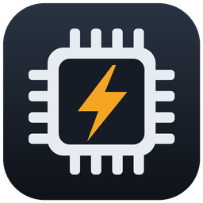

# FACILOC · versiones

Descargas de **FACILOC**, asistente de overclock guiado para Windows (hoy: MSI Z370 Gaming Plus con i5-8600K).

**Última versión: 1.4.1** → [FACILOC.exe](https://github.com/locometopa/faciloc-versiones/raw/main/FACILOC.exe)

1. Pon `FACILOC.exe` en una carpeta propia y ábrelo (pide permisos de administrador para leer los sensores).
2. Tus datos se guardan en `datos\` junto al .exe. Desde la 1.3.0 se actualiza solo al abrirse (te pregunta antes).

`version.json` indica la última versión y el SHA-256 del ejecutable.

## Cambios

- **1.4.1** — La prueba mide la frecuencia real (sin AVX Offset).
- **1.4.0** — Interfaz nueva (panel de control), BIOS «ahora → quedará», pantalla de carga.
- **1.3.0** — Actualizaciones automáticas al abrir.
- **1.2.0** — El programa pasa a llamarse FACILOC (antes OC-Z370).
- **1.1.0** — Prueba de refrigeración con gráfica comparada; copias de seguridad automáticas de los datos.
- **1.0.0** — Un solo ejecutable con icono; preparado para más placas.
